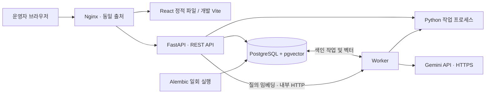

# 시스템 아키텍처

설계 초안 · 2026-11-18 (KST)

## 현재 기반과 제안 구조

기본 티켓 API, SOP·해결 티켓 지식 검색, 장애 분석 에이전트, 교대 운영과 인수인계를 제공한다. `GET /health`는 200과 `{"status":"ok"}`를 반환한다. API와 worker는 같은 Python 이미지를 사용한다. React 앱은 Vite로 빌드한다.

| 모듈 | 책임과 경계 |
| --- | --- |
| `auth`, `handover.schedule` | 로그인 세션과 배포 운영자의 근무조·회차 등록 |
| `tickets` | 티켓·상태·작업·이력과 트랜잭션 |
| `handover` | 근무조 권한, 티켓 운영 정보와 후속 작업, 자료 수집, 누락 규칙, 보고서 편집·확정·인수 확인 |
| `knowledge` | SOP 업로드와 추출, 해결 티켓 색인, pgvector 순위 계산 및 출처 조회 |
| `agent` | Gemini 어댑터, 함수 호출 허용 목록, 스키마 검증 및 실행 추적. 조회 도구는 업무 모듈에서 제공하는 읽기 함수만 호출한다. |
| `worker` | DB에서 AI와 인덱싱 작업을 확보하고 서비스 메서드를 호출한다. 리스·재시도·종료 상태를 관리한다. |
| React | 티켓, 분석, 지식 검색, 인수인계 화면과 공통 API 클라이언트. 같은 출처에서 API를 호출한다. |

라우터는 입력과 HTTP 계약을, 도메인 서비스는 권한·트랜잭션·전이 규칙을, SQLAlchemy 접근 코드는 저장과 조회를 맡는다. SDK 요청·응답은 `agent` 경계에서 내부 데이터로 변환한다. 작업 실행 기록과 결과를 PostgreSQL에서 연결하고, Gemini 네트워크 호출 동안 DB 트랜잭션을 열어두지 않는다. 외부 ITSM이 필요해지면 티켓 서비스의 명시적 명령·조회 계약에 변환 어댑터를 연결한다. Jira 외부 ID 매핑과 동기화 커서는 관련 요구가 확정되는 시점에 추가한다.

## 설계 선택

| 주제 | 채택안과 이유 | 검토한 대안과 비용 |
| --- | --- | --- |
| 서비스 구성 | 하나의 모듈형 애플리케이션 + 독립 실행 프로세스. 한 저장소에서 기능별 경계와 운영 단순성을 유지한다. | 마이크로서비스는 조직별 배포에 유리하지만 계약·운영 비용이 늘어난다. |
| AI 실행 | DB 작업 행 + 단일 worker, REST 폴링. 서버 재시작과 재조회가 가능하고 큐 인프라를 줄인다. | 동기 HTTP는 초기 구현이 쉽지만 긴 모델 응답에 연결이 종속된다. Redis/Celery는 다중 작업자에 유리하고 관리 요소가 늘어난다. |
| 검색 | pgvector 정확 코사인 검색. 업무 필터와 같은 트랜잭션 모델을 쓰며 소규모 시연에서 결과 재현이 쉽다. | HNSW는 데이터가 커질 때 유용하나 인덱스 비용과 필터 적용 후 재현율을 측정해야 한다. 별도 벡터 DB는 운영 부담을 추가한다. |
| 로그인 | 동일 출처의 서버 세션과 로컬 계정. 한 호스트에서 취소와 브라우저 세션 관리가 단순하다. | OIDC는 실조직 SSO에 적합하다. 계정 공급자와 운영 정책 확정이 필요하다. |
| Gemini | 함수 실행과 최종 JSON 생성을 별도 호출로 나눠 각 단계의 정책과 오류 처리를 통제한다. | 단일 요청의 도구·구조화 출력 결합은 호출 수를 줄일 수 있다. 모델·API별 호환성 확인 범위가 넓어진다. |

## 프론트엔드 화면

| 경로 | 주요 구성·동작 |
| --- | --- |
| `/login` | 사용자명·비밀번호, 오류 피드백, 로그인 후 이전 내부 경로로 복귀 |
| `/tickets` | 기본 진입 화면. 검색·상태·우선순위·보관 필터, 목록, 새 티켓, 페이지 이동 |
| `/tickets/new`, `/tickets/:id/edit` | 제목·증상·서비스·우선순위·발생 시각·영향·다음 조치 입력 |
| `/tickets/:id` | 진행 상태, 상태 전환·보관, 회차·담당자, 작업과 메모, 변경 이력, AI 장애 분석 링크 |
| `/knowledge`, `/knowledge/:id` | SOP 업로드와 목록, 처리 상태, 추출 텍스트·원본 다운로드·삭제·재처리 |
| `/knowledge/search` | 자연어 질의, SOP·해결 티켓 필터, 관련 청크와 원본 출처 |
| `/handovers` | 근무 회차, 자동 선정 티켓과 수동 포함·제외, 초안 생성과 과거 보고서 목록 |
| `/handovers/:id` | 입력 스냅샷, AI 원본 근거, 누락 답변, 운영자 편집, 재수집, 최종 확정과 인수 확인, 수정 이력과 후속 버전 |
| `/agent` 및 `?run={id}` | 질문과 티켓 선택, 분석 상태·근거, 마스킹된 도구 이력, 재실행 안내 |

공통 상태는 로딩, 빈 결과, 네트워크 오류, 권한 없음, 편집 충돌이다. 진행 중인 장애 분석은 약 1.2초 간격으로 폴링하고 완료·실패·화면 이탈 시 중단한다. 누락 정보와 추정은 구분하고 근거를 각 진단 단계 옆에 배치한다. 원문과 모델 출력은 텍스트 또는 제한된 Markdown으로 표시한다. 원시 HTML은 렌더링하지 않는다. 실패한 AI 실행에서도 티켓 수정과 인수인계 수동 편집을 제공한다.

### 키로 컴패니언

키로 컴패니언은 전용 코퍼스 환경(`APP_ENV=simulation`, DB `polytech_training_corpus`)에 로그인한 교육생의 교육 레이아웃에서 표시한다. 캐릭터 위치와 표시·정지 설정은 같은 탭의 `sessionStorage`에 저장한다. 코퍼스 개발 서버의 우측 하단 **컴패니언 → 상태 미리보기**에서 8개 상태를 확인하고 **자동**으로 복귀할 수 있다.

캐릭터를 잡으면 매달려 흔들린다. 빠르게 끌어서 놓으면 포인터의 최근 이동 방향으로 미끄러지듯 날아가며, 이동 경계에 닿으면 그 방향으로 잠깐 눌렸다가 돌아온다. 애니메이션 정지 또는 시스템의 모션 축소 설정을 켜면 드래그한 자리에 바로 놓인다.

`companion-context.tsx`는 경로·섹션, 역할, 실습·티켓·SOP·인계 식별자와 기존 화면 데이터에서 읽은 로딩·빈 결과·실패 상태를 제공한다. 티켓 종류·우선순위·상태, 분석 ID·단계, 작성 시작 여부도 담는다. 화면은 검색어·질문·작성 문구·인증 정보를 전달하지 않는다. 경로 변경 시 새 컨텍스트를 만들고, 기존 요청의 취소 여부를 확인해 늦게 도착한 응답을 무시한다.

`companion-hints.ts`는 상태 변화에서 이벤트를 만들고 정해진 방향 안내를 선택한다. 연결된 흐름은 티켓 목록과 상세 로드, 티켓 상태 변경, 빈 승인 SOP 검색, 분석 완료, 후속 작업 입력, 이전 근무조 인계 열기, 발신 초안·확정 인계 열기와 작성 시작이다. 준비 중인 힌트는 우선순위가 더 높은 힌트로 교체할 수 있다. 열린 말풍선은 클릭으로 닫고, 화면이나 해당 검색·분석 상태가 바뀌면 정리한다. 준비 상태는 기본 10초이며, 열린 말풍선은 이 제한을 적용하지 않는다. 탭 세션에서 힌트와 업무 ID·단계로 중복을 제한하고, 빈 SOP 검색은 60초 뒤 새 검색에서 다시 안내할 수 있다. 타임아웃 시에도 이력을 적용한다.

일반 클릭과 `openCompanionChat()`은 `dco:companion-chat-requested`를 발생시킨다. Hint Ready에서 캐릭터를 누르면 힌트가 먼저 열리고, **키로에게 질문**을 선택하면 채팅을 연다. 화면에 연결된 힌트는 승인된 힌트 유형 ID만 질문에 한 번 연결한다. 외부 이벤트가 넘긴 힌트 문구는 화면에 표시한다. 채팅이 열려 있는 동안 자율 이동을 멈추고, 응답 상태에 따라 대화·생각·기쁨·놀람 이미지를 보여 준다. 닫으면 대화를 보관하고 자율 행동을 재개한다. 개발 서버의 **힌트 테스트**와 **우선 힌트 테스트**에서 준비, 교체, 10초 만료, 화면 이동을 확인할 수 있다.

`CompanionChat.tsx`는 전송 시점의 페이지·실습·엔티티 식별자를 저장하고 질문마다 그 시점의 화면 이름을 표시한다. 이동 이후의 질문에는 최신 컨텍스트를 사용한다. `app/companion`은 접수와 워커 실행에서 교육생 및 실습 데이터 권한을 재검증한다. 기존 `AgentRun` 큐, Gemini 공급자, 임베딩 워커와 pgvector 검색을 재사용한다. 워커가 질문 유형을 규칙으로 분류하고, 현재 티켓과 작업 정보는 서버 DB에서 조회한다. 승인 SOP는 문서 요청·장애 진단·근거가 필요한 후속 질문에서 검색한다. 진단에서는 SOP 근거가 부족하거나 과거 사례를 요청하면 유사 장애도 조회한다. 티켓 요약과 일반 개념 설명은 SOP 검색을 생략한다. 모델에는 구조화된 질문과 근거를 한 번에 보내며 모델 호출을 분류용으로 추가하지 않는다. 출처 링크는 서버가 확인한 키로 조립하고 조회할 때도 자료 접근 권한을 확인한다.

탭에는 사용자별 대화 UUID와 열림 상태, 전송 확인 정보만 보관한다. 메시지와 출처는 서버에 8시간 보관한다. 업무 질문은 현재 티켓·실습과 충돌하는 과거 기록을 제외하고, 최근 성공한 대화 최대 네 건을 과거 컨텍스트로 분리해 모델에 전달한다. 대화 초기화는 이력과 진행 중인 응답을 제거한다. Gemini 실행 실패는 오류 상태로 표시되며, 모의 응답은 Fake 공급자를 명시적으로 선택한 환경에서 사용한다. 워커는 실행 시간, 공급자, 호출 시도 수, 오류 코드만 진단 로그에 남긴다. 채팅 UI와 업무 데이터 조회 계층은 [Companion Chat API](API.md#키로-컴패니언-채팅)로 연결된다.

티켓 상태의 의미와 전환 조건은 티켓 도메인의 업무 규칙에서 직접 답한다. 특정 티켓이 현재 상태가 된 이유는 해당 실습에서 접근할 수 있는 티켓의 최신 상태 변경 기록을 확인한다. 티켓을 선택하지 않았으면 상세 화면을 열도록 안내한다. 이 질문에는 SOP 검색과 모델 호출을 생략하며, 장애 점검과 SOP 질문은 기존 검색과 모델 처리 경로를 사용한다.

#### 사용자 승인 기반 실행

`app/companion/actions.py`는 사용자의 메시지에서 화면 이동·강조·검색창 포커스·SOP 열기 요청을 식별한다. Gemini는 채팅에 쓰는 JSON Schema에서 해당 제안을 구조화해 반환한다. 워커는 행동과 인자를 현재 화면의 등록 목록 및 실제 검색 근거와 대조한다. 승인 SOP가 여럿이면 검색으로 검증된 후보를 제시하고 교육생이 문서를 선택한다. SOP 검색과 등록된 섹션 설명은 읽기 전용 답변으로 완료한다.

서버는 기존 `AgentRun` 결과 안에 제안과 승인·실행 결과를 저장한다. 승인 요청은 로그인 세션, 대화, 화면 식별자, 페이지·실습·티켓, 만료 및 재사용 여부를 다시 확인한다. 행 잠금으로 승인과 취소가 한 번만 확정된다. 프런트엔드는 화면을 떠나거나 채팅을 닫으면 같은 화면의 제안을 무효화하고, 현재 브라우저 위치를 실행 직전에 다시 확인한다. 승인 로그에는 제안과 업무 ID, 행동, 승인·취소, 실행 결과와 오류 코드가 남는다.

브라우저 실행기는 기존 교육 화면의 History API와 등록된 UI 식별자를 사용한다. 대상 화면의 렌더링, 강조 표시 또는 입력 포커스를 확인한 후 결과를 서버에 보낸다. 모델의 응답은 사용자 승인 카드에 사용할 데이터로만 전달된다. [키로 실행 제안 API](API.md#키로-실행-제안)

## Docker Compose 배포 구조

| 서비스 | 공통·운영 | 개발 오버라이드 |
| --- | --- | --- |
| `db` | `pgvector/pgvector:0.8.7-pg17-bookworm` 후보, `db_data` named volume을 `/var/lib/postgresql/data`에 연결, `pg_isready`, 내부 DB 네트워크만 연결 | 별도 Compose 프로젝트와 볼륨. 포트 발행 없이 `docker compose exec db psql`로 접근 |
| `migrate` | DB healthy 이후 별도 소유자 자격으로 `alembic upgrade head` 실행 후 종료 | 동일, 시험 전 별도 테스트 DB 사용 |
| `api` | migration 성공 이후 시작. Nginx와 DB의 내부 네트워크에 연결. 8000은 컨테이너 내부 포트 | 소스 마운트와 Uvicorn reload |
| `worker` | migration 성공 이후 기동. 별도 스레드로 색인과 장애 분석 큐를 처리하고 내부 8001번에서 질의 임베딩을 제공한다. API와 `sop_files` 볼륨을 공유하며 `GEMINI_API_KEY`를 담당한다. | 기본 `fake`, 선택 설정 `gemini` |
| `nginx` | 다단계 Node 빌드 결과 서빙, `/api/`와 `/health`를 API로 프록시. HTTPS 443, HTTP 80은 TLS 리다이렉트 또는 인증서 발급용 | 개발 브라우저에는 Nginx의 `127.0.0.1:8080`만 발행. 화면과 HMR은 컨테이너의 Vite에 프록시 |
| `frontend` | 정적 파일은 Nginx 이미지에 포함 | Vite 개발 서버, 컨테이너 내부 포트 5173 |

- 공통 `compose.yaml`에 서비스, named volume, 웹 내부망(Nginx·API·개발 Vite), 데이터 내부망(API·worker·migrate·DB)을 정의한다. Nginx 호스트 포트용 진입 브리지와 worker의 Gemini 송신 브리지를 각각 추가한다. 개발은 기본 Compose가 자동으로 읽는 `compose.override.yaml`을 사용하고, 운영은 `compose.yaml`과 `compose.prod.yaml`을 명시한다. 공통 파일에는 호스트 포트 매핑을 두지 않는다. 최종 구성의 `docker compose config --quiet`와 외부 포트 상태로 확인한다. [Compose 시작 순서](https://docs.docker.com/compose/how-tos/startup-order/) · [운영 환경 구성](https://docs.docker.com/compose/how-tos/production/) · [네트워크](https://docs.docker.com/reference/compose-file/networks/)
- Nginx는 `/api/v1/…` URI를 보존해 전달하고 기존 `/health`를 프록시한다. SPA fallback은 UI 경로에만 적용한다. 운영에서 OpenAPI·상세 readiness는 내부 접근을 기본으로 한다. 신뢰할 프록시는 컨테이너 네트워크 기준으로 제한하고 Nginx가 전달 헤더를 설정한다. [Nginx 프록시 모듈](https://nginx.org/en/docs/http/ngx_http_proxy_module.html)
- Ubuntu에서 Docker Engine과 Compose 플러그인을 사용한다. 운영 환경의 인증서·갱신은 호스트에서 관리하고 Nginx에는 읽기 전용으로 설치한다. 호스트에서 Nginx 포트의 접근 범위를 검증한다. [Docker Engine Ubuntu 설치](https://docs.docker.com/engine/install/ubuntu/) · [Compose 플러그인](https://docs.docker.com/compose/install/linux/)
- 개발·운영의 프로젝트 이름, 데이터 볼륨, DB 비밀번호와 모델 설정을 분리한다. 저장소 밖의 권한 제한 환경 파일에서 worker에만 Gemini 키를 주입한다. 브라우저, `VITE_*`, 이미지 빌드 인자, 로그에는 키를 포함하지 않는다. 설정 확인 시 시크릿이 표시되는 전체 Compose 출력을 남기지 않는다. [Compose 서비스와 env_file](https://docs.docker.com/reference/compose-file/services/#env_file)
- 배포는 백업, 이미지 빌드·검증, 일회성 migration, API·worker·Nginx 재기동, smoke 순으로 확인한다. 호환되는 스키마만 이전 이미지로 되돌릴 수 있다. 호환이 깨진 경우 격리된 볼륨에서 백업을 복원하고 검증한 후 전환한다. DB는 `pg_dump`를 매일 생성해 호스트 밖에 보관하고 복원 시간을 측정한다. 단일 호스트 장애 동안 서비스 중단을 감수한다. [Docker 볼륨](https://docs.docker.com/engine/storage/volumes/) · [PostgreSQL pg_dump](https://www.postgresql.org/docs/17/app-pgdump.html)

업로드는 `POST /api/v1/sops`에서 전체 multipart 요청을 최대 8 MiB로 제한한다. Nginx와 FastAPI가 동일한 한도를 적용한다. 원본 파일은 UUID로 이름을 정해 `sop_files`에 저장한다. 백업에는 해당 볼륨과 DB의 메타데이터를 함께 포함한다. 브라우저 포트와 기존 API 경로는 유지한다.

## 운영 상태와 경계

- 인증은 서버 세션과 Argon2id 해시를 사용한다. 운영 쿠키는 `HttpOnly`, `Secure`, `SameSite=Lax`를 사용한다. 상태를 바꾸는 요청은 출처와 CSRF 토큰을 검사한다. API에만 CSRF 서명 키를 주입한다. Nginx는 클라이언트 주소별 로그인 속도를 제한한다. [현재 검증 범위](KNOWN_ISSUES.md)
- `GET /health`는 프로세스 생존, 내부 `GET /api/v1/ready`는 DB와 schema revision을 확인한다. Gemini 장애·키 부재·작업 지연은 AI 상태로 관측하며 일반 API는 계속 서비스한다.
- 로그는 `request_id`, `run_id`, 작업·도구명, 상태, 소요 시간, 오류 코드 중심으로 남긴다. 입력 전문, 쿠키, 인증 정보, 모델 원문과 내부 추론 데이터는 로그에서 제외한다. 요청 오류는 API 오류 형식으로 변환하고 사용자가 취할 수 있는 조치를 화면에 표시한다.
- 운영 점검은 DB 및 API readiness, 큐 대기 시간, 유실 리스, Gemini 429·5xx 비율, 색인 지연, 디스크·백업 상태를 대상으로 한다. worker가 둘 이상의 인스턴스로 늘어나는 경우에도 실행 ID와 리스로 결과 중복 반영을 막는다.

## 기술 버전 후보

2026-11-18 KST 공식 문서·공개 릴리스 기준의 설치 후보이다. 실제 Linux 컨테이너 설치, 종속성 해석, 잠금 파일과 이미지 digest 고정은 [개발 계획](TASKS.md)의 1단계에서 수행한다.

| 구성 | 후보와 근거 |
| --- | --- |
| 프론트엔드 | Node.js 24 LTS와 Vite 8.3.8, plugin-react 6.3.0, React·React DOM 19.3.1, TypeScript 7.0.2를 함께 검증한다. [Node.js LTS](https://nodejs.org/en/about/previous-releases) · [Vite 호환성](https://vite.dev/guide/) · [Vite 릴리스](https://github.com/vitejs/vite/releases/tag/v8.3.8) · [React 플러그인](https://github.com/vitejs/vite-plugin-react/releases/tag/plugin-react@6.3.0) · [React 릴리스](https://github.com/react/react/releases/tag/v19.3.1) · [TypeScript 레지스트리](https://registry.npmjs.org/typescript/latest) |
| API | 기존과 같은 Python 3.12 이미지에 FastAPI 0.163.2, Uvicorn 0.54.0, Pydantic 2.14.3 후보를 설치한다. [FastAPI 릴리스](https://pypi.org/project/fastapi/0.163.2/) · [Uvicorn 릴리스](https://pypi.org/project/uvicorn/0.54.0/) · [Pydantic 릴리스](https://pypi.org/project/pydantic/2.14.3/) · [FastAPI 예외 처리](https://fastapi.tiangolo.com/tutorial/handling-errors/) |
| DB | PostgreSQL 17 계열 + pgvector 확장 0.8.7, Python 패키지 SQLAlchemy 2.1.9, Alembic 1.20.1, psycopg[binary] 3.3.9, pgvector 0.5.1 후보를 사용한다. 이미지의 실제 PostgreSQL 패치가 지원되는 최신 17.x 기준에 맞는지 확인한다. [PostgreSQL 지원 버전](https://www.postgresql.org/support/versioning/) · [pgvector 이미지 태그](https://github.com/pgvector/pgvector#installation) · [SQLAlchemy 릴리스](https://pypi.org/project/SQLAlchemy/2.1.9/) · [Alembic 튜토리얼](https://alembic.sqlalchemy.org/en/latest/tutorial.html) · [psycopg 설치](https://www.psycopg.org/psycopg3/docs/basic/install.html) · [psycopg 릴리스](https://pypi.org/project/psycopg/3.3.9/) · [pgvector Python 릴리스](https://pypi.org/project/pgvector/0.5.1/) |
| Gemini·인증 | google-genai 3.4.0, argon2-cffi 25.1.0 후보. 모델 ID는 [에이전트 설계](AGENT.md)에 있다. [Google Gen AI SDK 릴리스](https://pypi.org/project/google-genai/3.4.0/) · [argon2-cffi 릴리스](https://pypi.org/project/argon2-cffi/25.1.0/) |
| 테스트·프록시 | pytest 9.2.0, HTTPX 0.28.1 및 Nginx 1.30 stable 이미지 후보. 이미지의 지원 패치를 확인해 고정한다. [pytest 릴리스](https://pypi.org/project/pytest/9.2.0/) · [HTTPX 릴리스](https://pypi.org/project/httpx/0.28.1/) · [Nginx stable](https://nginx.org/en/download.html) |
