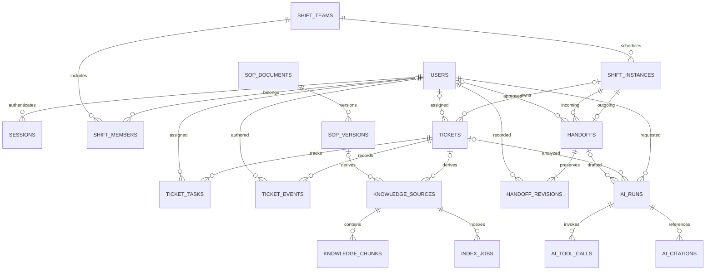

# 데이터베이스 설계

설계 초안 · 2026-11-18 (KST)

PostgreSQL 17과 pgvector를 사용한다. PK는 별도 표기가 없으면 UUID이며 시간은 `timestamptz`로 저장한다. 상태와 역할은 SQLAlchemy의 문자열 매핑 및 DB `CHECK`로 제한한다. API에서는 DB 식별자 외에 사람이 읽을 수 있는 티켓 번호를 표시한다.

## ERD

## 업무 테이블

| 테이블 | 주요 필드·제약 |
| --- | --- |
| `users` | `id`, 정규화한 `username UNIQUE`, `display_name`, `password_hash`, `is_active`, `created_at`. 계정 비활성화 시 세션을 무효화한다. |
| `sessions` | 세션 토큰 해시 PK, `user_id FK`, `created_at`, `expires_at`. 원본 세션 토큰은 쿠키에만 응답한다. CSRF 토큰은 서버의 API 전용 키와 세션 토큰으로 계산하고 상태 변경 시 상수 시간 비교한다. |
| `shift_teams` | `id`, `code UNIQUE`, `name`. |
| `shift_members` | `team_id FK`, `user_id FK`, 복합 PK, `role` (`operator`, `shift_lead`), `is_active`. 조 편성이 변경되어도 기존 감사 이력의 FK를 보존한다. |
| `shift_instances` | `id`, `team_id FK`, `starts_at`, `ends_at`, `ends_at > starts_at`, `starts_at UNIQUE`. 단일 운영 일정에서 시간 중첩을 차단한다. 인계조의 `ends_at`과 직후 회차의 `starts_at`이 일치할 때 인계할 수 있다. |
| `tickets` | `id`, 시퀀스 기반 `number UNIQUE`, `title`, `description`, `service`, `severity`, `status`, `detected_at`, `impact` NULL, `next_action` NULL, `recheck_at` NULL, `resolution` NULL, `resolved_at` NULL, `created_by FK`, `assignee_id FK` NULL, `shift_instance_id FK` NULL, `version`, `created_at`, `updated_at`, `archived_at` NULL. 담당자 지정 시 회차와 해당 조의 활성 소속을 검증한다. |
| `ticket_tasks` | `id`, `ticket_id FK`, `title`, `status` (`todo`, `in_progress`, `blocked`, `done`, `cancelled`), `assignee_id FK` NULL, `due_at` NULL, `note` NULL, `created_at`, `updated_at`. 티켓의 버전으로 동시 수정 제어. 완료·취소 전에 결과나 사유를 기록한다. |
| `ticket_events` | `id`, `ticket_id FK`, `actor_id FK`, `ticket_version`, `event_type`, `details JSONB`, `created_at`, `UNIQUE(ticket_id, ticket_version)`. 변경 전후 값, 작업 ID 또는 메모를 기록하는 추가 전용 이력이다. 한 명령의 여러 변경은 한 이벤트로 묶는다. |
| `handoffs` | `id`, `outgoing_shift_id UNIQUE FK`, `incoming_shift_id FK`, `status` (`draft`, `approved`), `version`, `created_by FK`, `approved_by FK` NULL, `approved_at` NULL, `created_at`, `updated_at`. 승인 상태와 승인자·시각의 일관성 및 서로 다른 회차를 제약한다. |
| `handoff_revisions` | `handoff_id FK`, `version`, 복합 PK, `actor_id FK`, `revision_type`, `source_cutoff_at`, `source_fingerprint`, `snapshot JSONB`, `body JSONB`, `acknowledgements JSONB`, `created_at`. 회차·티켓·작업·관련 메모·누락 항목을 스키마 버전이 있는 스냅샷으로 저장한다. 서버의 AI 결과 적용은 요청자의 ID로 귀속하고 AI 실행 ID를 함께 기록한다. 현재 리비전은 `handoffs.version`으로 찾는다. |

## 검색·실행 테이블

| 테이블 | 주요 필드·제약 |
| --- | --- |
| `sop_documents` | `id`, `slug UNIQUE`, `display_title`, `archived_at` NULL. |
| `sop_versions` | `id`, `document_id FK`, 양의 `version_number`, `title`, `sections JSONB`, `content_hash`, `published_at`, `retired_at` NULL, `UNIQUE(document_id, version_number)`. 문서당 현재 발행 버전 한 개를 부분 고유 인덱스로 보장한다. 기존 버전의 내용은 보존한다. |
| `knowledge_sources` | `id`, `ticket_id FK` 또는 `sop_version_id FK` 중 정확히 하나, `source_revision`, `content_hash`, `embedding_profile`, `state` (`pending`, `ready`, `failed`, `superseded`), `created_at`. 티켓 리비전은 이력의 티켓 버전, SOP는 발행 버전 번호다. 원본·리비전·프로필 조합에 부분 고유 인덱스를 둔다. |
| `knowledge_chunks` | `id`, `source_id FK`, `ordinal`, `section_key` NULL, `content`, `embedding vector(768)`, `UNIQUE(source_id, ordinal)`. 검색할 텍스트와 벡터를 함께 버전 관리한다. |
| `index_jobs` | `id`, `source_id UNIQUE FK`, `status`, `attempt_count`, `available_at`, `lease_token`, `lease_expires_at`, `error_code`, `created_at`, `finished_at`. 재색인은 실패 행을 재등록하거나 새 프로필의 소스로 등록한다. 실행 상태는 AI 큐와 같은 값 집합을 사용한다. |
| `ai_runs` | `id`, `kind` (`ticket_analysis`, `handoff_draft`), `ticket_id FK` 또는 `handoff_id FK` 중 용도에 맞는 한 개, `input_version`, 제한된 `input_snapshot JSONB`, `requested_by FK`, `idempotency_key`, `request_hash`, `status` (`queued`, `running`, `succeeded`, `failed`), `attempt_count`, `available_at`, `lease_token`, `lease_expires_at`, `provider`, `model_id`, `prompt_version`, `schema_version`, `result JSONB`, `error_code`, `retryable`, `created_at`, `started_at`, `finished_at`. `UNIQUE(requested_by, kind, idempotency_key)`. |
| `ai_tool_calls` | `id`, `run_id FK`, `attempt_no`, `ordinal`, 도구명, 시작 주체(모델/서버), 상태, 마스킹된 인자 요약, 참조 ID 배열, 소요 시간, 오류 코드, 시각, `UNIQUE(run_id, attempt_no, ordinal)`. 전체 모델 응답과 응답 서명은 저장하지 않는다. |
| `ai_citations` | `id`, `run_id FK`, `citation_key`, 기본 도구 실행 ID, `source_type` (`ticket`, `sop`, `handoff_snapshot`), `source_id`, `source_revision`, `locator`, `title`, 제한된 `excerpt`, `score` NULL, `UNIQUE(run_id, citation_key)`. 티켓/문서/스냅샷의 저장 시점 근거를 보존한다. 유형별 조회가 가능한 형태로 ID와 절을 검증하며 임의 URL은 저장하지 않는다. |

## 트랜잭션과 조회 인덱스

- 상태·필드·배정·작업·메모·보관을 변경할 때 티켓 행을 버전 조건으로 갱신하고 이벤트를 같은 트랜잭션에 추가한다. 최종 종료 및 보관 조건을 같은 트랜잭션에서 다시 검사한다. 다른 사용자의 변경을 발견하면 409를 응답한다.
- 회차 범위는 시작 시각 포함, 종료 시각 미포함이다. 교대 자료는 선택한 현재·직전 인계 회차 기준으로 생성 시점의 현재 상태를 읽는다. 미해결 및 미완료 작업이 있는 해결 티켓 중 선택 회차 배정, 미배정, 선택 회차보다 먼저 끝난 회차에 배정된 건을 포함한다. 마지막 유형은 이월로 표시한다. 선택 회차 담당 또는 미배정 티켓 중 `resolved_at`이 회차 범위에 속하고 생성 시각 이전인 현재 해결·종료 건도 포함한다. 회차 전체의 과거 상태 재구성은 범위 밖이다.
- 교대 자료 캡처·승인과 티켓·작업·회차의 관련 변경은 모두 같은 DB 트랜잭션 advisory lock을 짧게 획득한다. 정렬된 대상 UUID·버전, 회차 정보와 누락 ID를 해시해 초안과 승인 시점을 비교한다. 시간 경과로 마감 초과 규칙이 추가된 경우도 변경으로 본다. 승인은 승인자·시각·승인 리비전·확인 사유를 한 트랜잭션에 기록한다. 승인된 본문과 승인 기록은 업무 경로에서 변경할 수 없다.
- 작업 확보는 `FOR UPDATE SKIP LOCKED`로 진행한다. 커밋 후 네트워크를 호출하고 리스 토큰이 일치할 때만 결과를 반영한다. 재시작으로 리스가 만료되면 제한된 횟수만 재실행한다. 인수인계 리비전이 바뀌면 실행 결과를 보존하며 초안에 적용하지 않는다. [PostgreSQL 행 잠금](https://www.postgresql.org/docs/17/sql-select.html#SQL-FOR-UPDATE-SHARE)
- 티켓은 `(updated_at DESC, id DESC)`, `(shift_instance_id, status)`에 활성 목록용 인덱스를 둔다. 작업은 `(ticket_id, status)`, 이벤트는 `(ticket_id, ticket_version)`, 양쪽 큐는 대기 행의 `(available_at, id)`와 실행 중 행의 `lease_expires_at`, AI 실행 목록은 `(ticket_id, created_at)`와 `(handoff_id, created_at)`를 사용한다. 티켓 분석은 `(ticket_id, input_version)`에 대기·실행 중 행만 포함하는 부분 고유 인덱스로 중복 접수를 막는다.
- pgvector를 Alembic 초기 리비전에서 생성한다. 검색은 활성 발행 SOP와 비보관 해결 이력이 있는 `resolved`·`closed` 티켓 중 현재 소스 리비전·임베딩 프로필이 일치하는 `ready` 청크만 대상으로 정확 코사인 거리를 계산한다. 변경 시 기존 소스는 즉시 제외한다. 새 벡터 전체와 `ready` 상태는 한 트랜잭션에서 커밋한다. 서로 다른 임베딩 프로필은 검색에서 섞지 않는다. [pgvector 검색과 인덱스](https://github.com/pgvector/pgvector#querying)
- 초기화·스키마 수정에는 별도 역할을 사용하고 API·worker에는 업무 테이블 접근 권한을 부여한다. 업무 증적의 참조는 삭제 제한을 기본으로 한다. 운영의 보존·파기 정책은 실데이터 반입 전에 확정한다.
