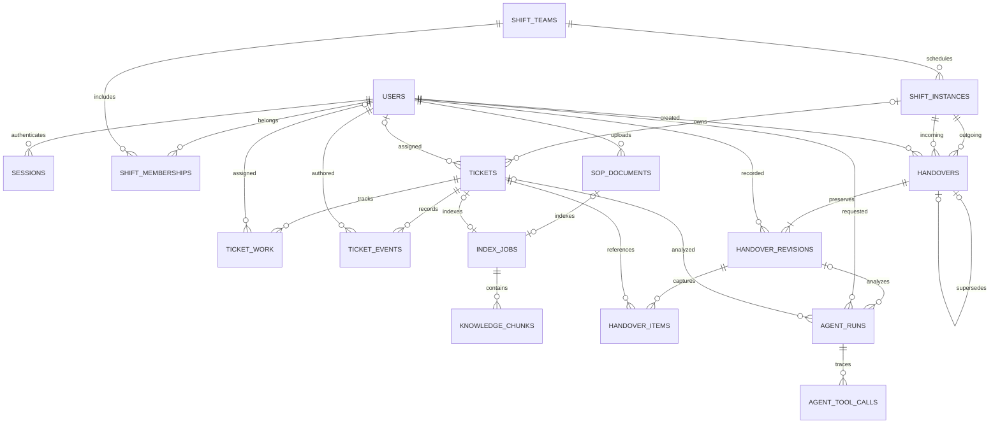

# 데이터베이스 설계

설계 초안 · 2026-11-18 (KST)

PostgreSQL 17과 pgvector를 사용한다. PK는 별도 표기가 없으면 UUID이며 시간은 `timestamptz`로 저장한다. 상태와 역할은 SQLAlchemy의 문자열 매핑 및 DB `CHECK`로 제한한다. API에서는 DB 식별자 외에 사람이 읽을 수 있는 티켓 번호를 표시한다.

4단계 Alembic 리비전 `0004_handover`는 근무조·소속·회차, 후속 작업, 인수인계·리비전·티켓 스냅샷을 추가한다. 기존 티켓과 분석 실행에 nullable 열을 추가하며 운영 데이터의 변환은 필요 없다.

## ERD

## 업무 테이블

| 테이블 | 주요 필드·제약 |
| --- | --- |
| `users` | `id`, 정규화한 `username UNIQUE`, `display_name`, `password_hash`, `is_active`, `created_at`. 계정 비활성화 시 세션을 무효화한다. |
| `sessions` | 세션 토큰 해시 PK, `user_id FK`, `created_at`, `expires_at`. 원본 세션 토큰은 쿠키에만 응답한다. CSRF 토큰은 서버의 API 전용 키와 세션 토큰으로 계산하고 상태 변경 시 상수 시간 비교한다. |
| `shift_teams` | `id`, `name UNIQUE`. |
| `shift_memberships` | `team_id FK`, `user_id FK`, 복합 PK, `is_lead`. 계정 활성 여부는 `users`에서 확인한다. |
| `shift_instances` | `id`, `team_id FK`, `starts_at UNIQUE`, `ends_at`, IANA `timezone`, `ends_at > starts_at`. PostgreSQL exclusion 제약으로 단일 일정의 시간 중첩을 차단한다. 인수조는 종료 시각에 시작하는 별도 근무조다. |
| `tickets` | 기존 티켓 열과 버전, nullable `owner_id FK`, `shift_instance_id FK`, `warnings`, `approval_required`. 담당자 지정 시 회차와 해당 조의 활성 소속을 검증한다. |
| `ticket_work` | `id`, `ticket_id FK`, `title`, `status` (`todo`, `in_progress`, `blocked`, `done`), nullable `owner_id FK`, `due_at`, `note`. 작업 변경과 티켓 변경은 티켓 버전을 공유한다. |
| `ticket_events` | `id`, `ticket_id FK`, `actor_id FK`, `ticket_version`, `event_type`, `details JSONB`, `created_at`, `UNIQUE(ticket_id, ticket_version)`. 변경 전후 값, 작업 ID 또는 메모를 기록하는 추가 전용 이력이다. 한 명령의 여러 변경은 한 이벤트로 묶는다. |
| `handovers` | 인계·인수 회차 FK, 고정 근무 기간, 보고서 상태·버전·수집 버전, 생성·확정·인수 확인 사용자와 시각. 회차별 원본 한 건과 선행 확정본당 후속 버전 한 건을 제약한다. `supersedes_id`는 선행 확정본의 FK다. |
| `handover_revisions` | `(handover_id, version)` PK, 종류, 수정자·시각, `content_snapshot JSONB`. 본문, 선택 목록, 수집 시각, 회차 정보, 수집 리비전 및 상태를 저장한다. |
| `handover_items` | `(handover_id, snapshot_version, ticket_id)` PK, 수집 리비전 및 티켓 FK, `ticket_snapshot JSONB`. 티켓 버전, 업무 상태, 작업과 변경 이력, 누락 질문을 보존한다. |

## 검색·실행 테이블

| 테이블 | 주요 필드·제약 |
| --- | --- |
| `sop_documents` | UUID, 제목·파일명·MIME·크기, 내용 SHA-256 고유값, 추출 텍스트, 등록자·시각. 원본 경로는 `sop_files` 볼륨의 `{id}.upload`로 계산한다. |
| `index_jobs` | 원본 UUID를 PK로 사용한다. SOP 또는 티켓 중 한 개에만 FK가 연결된다. 상태 `PENDING`·`PROCESSING`·`COMPLETED`·`FAILED`, 티켓 버전, 시도 횟수·실행 가능 시각, 리스·오류·완료 프로필을 저장한다. |
| `knowledge_chunks` | `source_id`는 작업의 원본 UUID를 참조한다. 청크 순번, 텍스트, PDF 쪽·Markdown 제목, `vector(768)`, 모델과 프로필, 생성 시각을 저장한다. `UNIQUE(source_id, chunk_index)`가 중복을 막는다. |
| `agent_runs` | 요청자·선택 티켓 FK, 마스킹한 질문, 큐 상태, 모델·공급자, 리스와 실행 시각, 결과와 사용량 JSONB, 오류 정보. 인수인계 유형은 `(handover_id, handover_version)` 복합 FK로 수집 리비전을 참조한다. 대기·조사 중인 실행에 사용자별 및 보고서별 부분 고유 인덱스를 적용한다. |
| `agent_tool_calls` | 실행 FK, 순번·이름·상태, 안전한 인자 요약과 근거 키 JSONB, 소요 시간·생성 시각. `UNIQUE(run_id, sequence)`가 순서 중복을 막는다. |

## 트랜잭션과 조회 인덱스

SOP 삭제는 문서, 작업, 청크를 FK cascade로 정리한다. 커밋 후 원본 파일을 삭제한다. 프로세스 중단이나 파일 삭제 오류로 남은 원본은 worker가 주기적으로 정리한다. 티켓은 재개하거나 보관하면 작업과 청크가 검색 범위에서 제거된다.

- 상태·필드·배정·작업·메모·보관을 변경할 때 티켓 행을 버전 조건으로 갱신하고 이벤트를 같은 트랜잭션에 추가한다. 최종 종료 및 보관 조건을 같은 트랜잭션에서 다시 검사한다. 다른 사용자의 변경을 발견하면 409를 응답한다.
- 회차 기간은 시작 시각을 포함하고 종료 시각을 제외한다. 해당 범위의 티켓 변경 이벤트는 수집 기준 시각까지만 선정 조건에 포함한다. 선택 회차·이전 회차 배정 및 미배정 티켓의 현재 상태와 작업은 수집 시점에 읽는다. 과거 특정 순간의 상태 재구성은 범위 밖이다.
- 티켓·작업·근무 회차 변경과 보고서 수집·확정에 같은 트랜잭션 advisory lock을 사용한다. 확정 시 현재 수집 결과와 저장된 전체 스냅샷을 비교한다. 확정·인수 확인은 각 수행자·시각과 리비전을 한 트랜잭션에 기록한다. 런타임 역할의 리비전·항목 권한은 조회와 추가다.
- 작업 확보는 `FOR UPDATE SKIP LOCKED`로 진행한다. 커밋 후 네트워크를 호출하고 리스 토큰이 일치할 때 결과를 저장한다. 만료된 리스는 실패로 표시하며 운영자가 새 분석을 요청할 수 있다. [PostgreSQL 행 잠금](https://www.postgresql.org/docs/17/sql-select.html#SQL-FOR-UPDATE-SHARE)
- 기존 티켓 조회 인덱스와 pgvector 데이터는 유지한다. `0003_agent`는 `agent_runs`, `agent_tool_calls`와 실행 큐·사용자별 부분 고유 인덱스를 추가한다. 대기 작업은 `FOR UPDATE SKIP LOCKED`로 확보하고, 요청자 이외의 조회를 제한한다.
- pgvector 확장은 최초 리비전에 있고, `0002_knowledge`는 지식 테이블과 권한을 추가하며 기존 미보관 해결 티켓을 대기 큐에 넣는다. 검색은 `COMPLETED`이고 임베딩 프로필과 현재 티켓 버전이 일치하는 청크의 정확 코사인 거리를 계산한다. B-tree는 프로필·원본 조회와 작업 일정에 사용한다. 새 벡터와 완료 상태를 같은 트랜잭션에 저장한다. [pgvector 검색과 인덱스](https://github.com/pgvector/pgvector#querying)
- 초기화·스키마 수정에는 별도 역할을 사용하고 API·worker에는 업무 테이블 접근 권한을 부여한다. 업무 증적의 참조는 삭제 제한을 기본으로 한다. 운영의 보존·파기 정책은 실데이터 반입 전에 확정한다.
