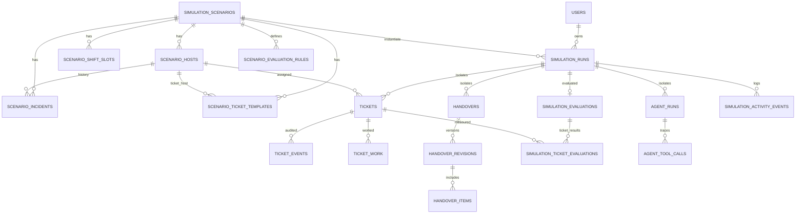

# ERD — 교육 시뮬레이터 논리 데이터 모델·마이그레이션 계약

- 상태 · **통합 PRD 최종 후보 연계**. 필드 이름과 물리 제약은 구현 설계에서 확정한다.
- 제품 기준 · [통합 PRD 최종 후보](PRD-merged-draft.md) · [API 계약](API_SPEC.md)
- 기존 운영 자료 · [기존 PRD](PRD.md) · [현행 갭 분석](architecture-gap-analysis.md)
- 모델링 원칙: **기존 운영용 테이블 재사용 우선**, 새 시뮬레이션 루트 추가, 실행별 격리, 레거시 행 보존

## 1. 기존 코드가 확인한 데이터 구조 (재사용)

| 현행 테이블 | 활용/변경 대상 | 근거(정적 분석) |
|---|---|---|
| `users`, `sessions` | 기존 인증 유지, 회원가입 로직 보강 | `app/models.py:13`, `app/auth.py` |
| `tickets`, `ticket_events`, `ticket_work` | 기존 버전·감사·작업 모델 유지, 실행 ID/host FK·복합 참조 추가 검토 | `app/models.py:33,87`, `app/handover/models.py:37` |
| `shift_teams`, `shift_memberships`, `shift_instances` | 기존 운영 스케줄 유지; 교육은 버전 고정 슬롯 사용 | `app/handover/models.py:11` |
| `handovers`, `handover_revisions`, `handover_items` | 기존 스냅샷/리비전 유지; 교육 실행/슬롯 연결·확정 처리 추가 | `app/handover/models.py:51` |
| `sop_documents`, `index_jobs`, `knowledge_chunks` | 승인된 공통 SOP와 실행 범위 티켓 검색, profile·버전 유지 | `app/knowledge/models.py:26` |
| `agent_runs`, `agent_tool_calls` | 실행 범위·요청자 연결, worker/도구 범위 필터 | `app/agent/models.py:11` |

**주의:** 기존 스키마의 실제 PK/컬럼 타입/enum/constraint를 이 문서만으로 확정할 수 없다. 마이그레이션 이전 `alembic current`, 모델 정의 및 revision `0001`~`0004` 검증 필요.

## 2. 목표 논리 ERD



위 Mermaid는 *관계의 방향*을 나타내는 논리 모델이다. 기존 테이블 컬럼 정의를 그대로 덮어쓰거나 운영 FK를 삭제하라는 뜻이 아니다. `SCENARIO_TICKET_TEMPLATES`와 `SIMULATION_ACTIVITY_EVENTS`는 아래에서 **제안**하는 명시적 구조이고, 현행 `app/knowledge/demo.py` 시드 형식에 따라 통합 가능하다.

## 3. 신규 테이블 제안 (필드·제약)

### `simulation_scenarios`

| 필드 | 타입(제안) | 제약/의미 |
|---|---|---|
| `id` | uuid | PK |
| `scenario_key` | text | NOT NULL |
| `version` | text | NOT NULL, `(scenario_key, version)` UNIQUE |
| `title` | text | NOT NULL |
| `timezone` | text | 기본 `Asia/Seoul` |
| `virtual_start_at` | timestamptz | 고정 시작 가상 시점 |
| `is_published` | boolean | 공개된 버전은 불변 |
| `config` | jsonb | Bot 초기 보고서·평가 규칙 버전·근거 버전 등 **검증된** 설정 |

### `scenario_shift_slots`

`id uuid PK`, `scenario_id uuid FK`, `slot_order smallint`, `crew_code text (A/B/C/D)`, `shift_type text (DAY/NIGHT)`, `starts_at timestamptz`, `ends_at timestamptz`, `actor_type text (BOT/TRAINEE)`.

- `(scenario_id, slot_order)` UNIQUE. 발행 검증에서 이전·현재·다음 **정확히 3개**의 순서와 인접한 시간 경계, `BOT → TRAINEE → BOT`을 확인한다. 실행은 이 발행 슬롯을 참조한다.
- A/B/C/D 조 코드, `Asia/Seoul` 날짜와 오프셋을 사용한다. 주간 08:00–20:00, 야간 20:00–익일 08:00이다. 최초 현재 슬롯은 주간이다. 장기 로테이션 계산은 MVP 범위에서 제외한다.

### `scenario_hosts`

`id uuid PK`, `scenario_id uuid FK`, `host_key text`, `hostname text`, `aliases jsonb`, `initial_state jsonb`; `(scenario_id,host_key)` UNIQUE.

- `host_key`는 표시명 변경과 분리된 불변 논리 자산 키.
- 기존 `tickets`가 호스트 모델을 갖고 있지 않으므로 새 테이블과 FK 추가를 권장.

### `scenario_incidents`

`id uuid PK`, `scenario_id uuid FK`, `scenario_host_id uuid FK`, `incident_key text`, `occurred_at timestamptz`, `error_code text`, `summary text`, `resolution text`, `source_type text` 기본 `synthetic`, `visibility text` 기본 `private`, `metadata jsonb`.

- 과거 합성 이력은 참조 전용이며 실행 `tickets`로 복제하거나 평가 후보에 넣지 않는다. 필요하면 승인된 이력만 별도 검색 소스로 색인한다.
- 공통 사고의 검색·출처 열람에는 대상 티켓 문맥이 필요하다. 같은 시나리오 버전, 명시적 `shared_approved` 승인 및 `occurred_at < ticket.detected_at`를 확인한다. 동일 호스트 이력은 대상 티켓의 호스트 일치까지 요구한다. RAG/worker 후보에 이 조건을 랭킹 전에 적용한다.

### `scenario_ticket_templates` (**제안**)

`id uuid PK`, `scenario_id uuid FK`, `scenario_host_id uuid FK`, `template_key text`, `initial_ticket jsonb`, `origin text (INITIAL | CARRYOVER)`, `detected_at timestamptz`. `(scenario_id,template_key)` UNIQUE.

- 초기 실습(`INITIAL`)·이전 Bot 이월(`CARRYOVER`) 템플릿을 신규 `tickets.id`로 복제하고 출처를 보존한다. 이월 티켓은 이전 Bot 보고서가 참조하는 템플릿 중 실제 인계 대상이다. 보고서 스냅샷에는 같은 실행의 복제 ID를 연결한다. 두 유형 모두 필수 평가 대상이다.
- 기존 `knowledge/demo.py` 시드를 버전화하는 대안도 가능. 다만 **발행된 버전은 불변**이어야 함.
- 후속 단계의 `action_rules`에는 행동별 사전 조건과 결과를 선언. 실제 조치와 단순 메모는 구별.

### `simulation_runs`

`id uuid PK`, `user_id FK users`, `scenario_id FK`, `status text CHECK (ACTIVE, COMPLETED)`, `started_at timestamptz`, `completed_at timestamptz NULL`, `incoming_report_snapshot jsonb`, `start_request_key varchar(128) NOT NULL`. 후속 단계에 확정 보고서와 리비전 FK를 추가한다.

- `NOT_STARTED`는 해당 사용자에게 현재 ACTIVE 행이 없는 홈 상태다. 과거 완료 행은 존재할 수 있다.
- `status='COMPLETED'`이면 `completed_at IS NOT NULL` 및 확정 보고서 참조를 검사.
- 사용자당 ACTIVE 1개 (partial UNIQUE); `(user_id,start_request_key)` UNIQUE.
- 실행 생성은 호스트/티켓/리포트 링크 복제와 **원자적 트랜잭션**.
- 완료 후 실행 원본은 변경 불가. 재실습은 신규 실행.
- 확정 보고서·리비전은 같은 실행의 발신 보고서를 참조한다. 빈 유효 초안의 초기화 시점은 구현에서 정하며 AI 작업에 의존하지 않는다.

### `simulation_activity_events` (**제안**)

`id uuid PK`, `simulation_run_id FK`, `ticket_id NULL`, `event_type text`, `event_sequence bigint`, `occurred_at timestamptz` (서버 기록 시각), `payload jsonb`, `actor_type text`, `source_ref text`.

- 티켓 기존 `ticket_events`/`ticket_work`와 중복 기록을 최소화; SOP 열람, 호스트 조회, 인계 수신 확인 등 기존 감사 이력에 없는 **교육 행동** 위주.
- 평가 규칙에서 '열람'과 '실제 활용'을 구분.

### `scenario_evaluation_rules` (**제안**)

`id uuid PK`, `scenario_id FK`, `rule_version text`, `rule_code text`, `applies_to jsonb`, `definition jsonb`, `is_enabled boolean`; `(scenario_id,rule_version,rule_code)` UNIQUE.

- 규칙 버전은 확정 평가와 함께 고정. 결과는 `PASS | NOT_MET | NOT_OBSERVED | NOT_APPLICABLE`.

### `simulation_evaluations`

`id uuid PK`, `simulation_run_id uuid FK UNIQUE`, `handover_id uuid FK`, `handover_revision int`, `rule_version text`, `input_snapshot jsonb`, `rules_status text`, `explanation_status text`, `rule_summary jsonb`, `natural_language_summary jsonb`, `created_at timestamptz`, `updated_at timestamptz`.

- 동일 실행의 최종 확정 평가 레코드는 한 건이다. 확정과 함께 `rules_status=PENDING`, `explanation_status=NOT_STARTED`를 기록한다.
- 규칙 상태는 `PENDING | PROCESSING | READY | FAILED`다. 규칙 결과를 저장하고 `READY`로 바꾸는 시점에 설명 처리를 `PENDING`으로 예약한다. 설명 상태는 `NOT_STARTED | PENDING | PROCESSING | READY | FAILED`다.
- 두 단계의 시도 횟수, 처리 가능 시각, lease, 마지막 오류는 독립적으로 추적한다. 하나의 큐에 처리 유형을 두거나 단계별 작업으로 분리할 수 있다. claim과 결과 발행은 상태 및 lease를 확인한다.
- 확정 리비전과 규칙 입력은 고정한다. 규칙 결과가 `READY`이면 설명 대기·실패와 무관하게 조회할 수 있다. 설명 재시도는 기존 규칙 결과와 확정 원본을 보존한다.

### `simulation_ticket_evaluations`

`id uuid PK`, `evaluation_id uuid FK`, `ticket_id uuid FK`, `activity_status text (ATTEMPTED/NOT_ATTEMPTED)`, `rule_results jsonb`, `evidence jsonb`, `explanation jsonb`. `(evaluation_id,ticket_id)` UNIQUE. MVP의 처리 상태는 부모 평가의 규칙/설명 상태로 표현한다.

- 확정 입력의 `INITIAL`, `CARRYOVER` 전체에 상세 레코드를 생성한다. 무조치·인계 누락·보관 여부는 대상을 바꾸지 않는다.
- `USER_CREATED`는 작업·감사·인계 원본을 보존하며 상세 레코드를 생성하지 않는다. 과거 사고 참조 자료와 레거시 운영 행에는 교육 평가를 생성하지 않는다.
- 평가 결과에서 사용한 이벤트·작업·문서 링크는 같은 실행에 속하거나 승인된 공통 자료여야 함.

## 4. 기존 테이블 확장(목표, 최종 DDL은 현행 제약 대조)

| 테이블 | 변경 제안 | 호환성 유의사항 |
|---|---|---|
| `tickets` | `simulation_run_id NULL`, `scenario_ticket_template_id NULL`, `scenario_host_id NULL`, 교육 출처 `training_origin` (`INITIAL`, `CARRYOVER`, `USER_CREATED`) | 복제된 티켓은 템플릿과 일치하는 출처, 사용자가 생성한 티켓은 템플릿 없는 `USER_CREATED`를 보존한다. 레거시 행은 실행·교육 출처가 없고 기존 상태값·번호·버전·인덱스를 유지한다. |
| `ticket_events`, `ticket_work` | 필요 시 `simulation_run_id` 연결 및 `(run_id,ticket_id)` 복합 FK | 기존 이벤트·작업이 다른 run의 티켓에 연결되지 않게 검증 |
| `handovers` | `simulation_run_id NULL`, 교육 발신은 현재 슬롯, 수신은 다음 Bot 슬롯에 연결 | 운영의 교대별 유일 인계와 교육의 실행별 발신 보고서 한 건을 별도 무결성 조건으로 둔다. 교육 슬롯에 기존 운영 회차 FK를 대체·병행하는 물리 방법은 설계에서 정한다. |
| `handover_items/revisions` | 부모 실행/티켓 범위 검증, 저장 시 원본 버전 기준과 확정 경고 보존 | 기존 운영 리비전·snapshot 포맷 유지 |
| `agent_runs` | `simulation_run_id NULL` 및 도구 후보 범위 | 큐/worker가 부모 실행을 읽어 모든 도구 호출에 전파 |
| `knowledge_chunks`, indexing | 실행 티켓·승인 공통 SOP·사고의 출처 범위와 버전 연결 | 결과 top-K 계산 전에 실행/공개/시점 조건을 적용하고 보관·프로필·버전 규칙을 유지한다. 검색·worker·출처 링크가 같은 기준으로 자료를 읽는다. |

실행 id가 없는 기존 운영 행을 **임의 사용자·시뮬레이션에 할당하지 않는다.** 교육 요청에서는 legacy NULL row를 기본 배제한다. 기존 운영 API 사용자의 권한·정책은 별도 보호한다.

## 5. 크로스-런 무결성과 권한 모델

1. `tickets`: `UNIQUE(simulation_run_id,id)` (교육 범위), 모든 자식/보고서 항목은 `(simulation_run_id, ticket_id)`를 함께 검증.
2. `scenario_hosts`/`scenario_shift_slots`: 실행의 scenario_id와 자산·슬롯의 scenario_id가 동일해야 한다. 이를 위해 복합 FK, 검증 트리거 또는 트랜잭션 검증 사용.
3. `simulation_evaluations`: `simulation_run_id` UNIQUE. 티켓 평가는 `(evaluation_id,ticket_id)` UNIQUE이며 부모 평가와 티켓의 실행이 같고 출처가 `INITIAL` 또는 `CARRYOVER`여야 한다.
4. 모든 실행 접근은 세션의 `user_id`로 `simulation_runs.user_id`를 검사. UUID를 아는 것만으로 접근 불가.
5. RAG/worker 도구/인용 링크에도 동일 소유권/공통 공개 범위 적용; 단순 쿼리 결과 후 필터링 금지.
6. DB RLS는 방어 심층화의 **선택사항**. 애플리케이션 접근검사와 검색범위 검증은 필수.

## 6. 권장 인덱스(제안 SQL)

```sql
CREATE UNIQUE INDEX uq_simulation_run_active
  ON simulation_runs(user_id) WHERE status = 'ACTIVE';
-- Phase 1의 시작 키는 NOT NULL이며 uq_simulation_run_request 제약으로 유일성을 보장한다.
CREATE INDEX idx_sim_run_user_history
  ON simulation_runs(user_id, started_at DESC, id);
-- 기존 tickets에 컬럼 추가가 확인된 경우에만 적용
CREATE INDEX idx_tickets_sim_run_updated
  ON tickets(simulation_run_id, updated_at DESC, id)
  WHERE simulation_run_id IS NOT NULL;
CREATE INDEX idx_scenario_incidents_host_time
  ON scenario_incidents(scenario_host_id, occurred_at DESC, id);
-- 규칙·설명 작업의 물리 배치 확정 후 (처리 단계, 상태, 처리 가능 시각) 큐 인덱스 검토
```

위 SQL은 **DDL 초안**이며 실제 적용 전 기존 타입·컬럼·운영 인덱스와 충돌을 검사해야 한다.

## 7. 인계 확정 원자성 및 경쟁 조건

교육 확정은 [단일 finalize API](API_SPEC.md#49-인계-확정--실습-종료)에 연결한다. 실행·멱등 키·요청 내용 식별값과 확정 리비전/성공 응답의 연결을 영속화한다. 동일 DB 트랜잭션에서 다음 작업을 수행한다.

1. `simulation_runs` 실행 행 잠금(`FOR UPDATE` 권장)과 사용자 소유권을 확인한다. 저장된 동일 요청은 결과를 재사용한다. 신규 확정은 ACTIVE 초안의 리비전을 검증한다.
2. 요청의 보고서 리비전과 수집 당시 원본 버전을 확인한다. 보고서의 편집·재수집 또는 원본 버전 변경은 충돌이다. 파생 경고의 변경은 버전 비교에서 제외한다.
3. 요청과 보고서의 구조·참조 무결성을 검증한다. 업무상 누락은 경고로 수집한다. 후보에서 빠진 초기·이월 티켓도 확정 입력에 포함한다.
4. 보고서 최종 리비전과 해당 경고를 고정한다.
5. `simulation_runs.status=COMPLETED`, `completed_at`·확정 보고서/리비전 기록.
6. 고정된 `input_snapshot`·`rule_version`, `rules_status=PENDING`, `explanation_status=NOT_STARTED`를 가진 평가를 한 건 예약한다.
7. 커밋 후 worker가 규칙, 이어서 설명을 처리한다.

티켓·작업 변경도 동일한 실행 잠금 순서에 참여해 확정 이후 늦게 커밋되는 경쟁을 막는다. 동일 멱등 키와 요청의 성공 응답은 확정 결과와 함께 식별·보존한다. 재전송은 기존 응답을 반환하고 완료 이후 이전 초안 버전으로 들어온 별개 요청은 버전 충돌로 처리한다. 확정·평가·AI 처리의 동시성은 각각의 무결성 조건을 유지한다.

## 8. Phase 1 물리 스키마와 Alembic 마이그레이션

- `0005_simulation_foundation`은 시나리오, 슬롯, 호스트와 티켓 템플릿, 실행, 실행별 호스트 상태를 추가한다. 발행 슬롯과 고정 시작 시각은 시나리오에서 조회한다. 초기 교육 티켓에는 실행, 시나리오, 호스트, 템플릿, 출처를 연결한다. 복합 FK가 각 연결의 시나리오·호스트 일치를 검증한다. Bot 보고서의 템플릿 키는 실행별 복제 티켓 ID로 바꿔 저장한다.
- 사용자 행동 이벤트는 향후 `(occurred_at, event_sequence)`로 정렬하며 실행별 이벤트 순번의 유일성을 보장한다. 종료 시 행동 범위와 평가 규칙 버전을 고정한다. 소요 시간과 근무시간 준수 여부는 평가에서 제외한다. 종료 후 도착한 AI 결과는 분석 이력에만 저장한다.
- 실행은 근무 종료 시각과 독립적이다. 교육 발신 인계 최종 확정이 유일한 완료 전이다. 인계 FK와 평가 스냅샷은 후속 단계에서 추가한다.
- 운영 행의 교육 필드는 모두 NULL이다. 기존 운영 회차 FK를 유지하며 실습은 발행된 슬롯을 참조한다. 티켓 UUID는 실행마다 새로 생성하며 표시 번호는 현행 전역 INC 시퀀스를 사용한다.


- 알려진 체인: `0001_ticket_foundation → 0002_knowledge → 0003_agent → 0004_handover`. 신규 revision 예: `0005_simulation_foundation`.
- 1단계 additive 변경: 신규 테이블/nullable 컬럼/보조 인덱스. 기존 운영 데이터 변경 금지.
- 2단계 합성 승인 데이터 변환/시나리오 템플릿 발행/참조 검증.
- 3단계 범위 검증 및 복합 제약 추가/교육 기능 활성화.
- 테스트: 빈 DB upgrade, 레거시 복제 upgrade, 이전 SOP/임베딩/리비전 보존, 스키마 readiness, 실행 실패 롤백, DB + SOP volume 복원.
- 교육 실행이 한 건이라도 있으면 Phase 1 downgrade를 차단한다. 운영 환경에서 자동 downgrade는 금지한다.

## 9. 구현 전 확인 항목

- [ ] 기존 모델/제약/enum과 제안 구조 충돌 목록화
- [ ] 재사용 가능한 `ticket_work`/`ticket_events`와 새 activity event 간 중복 최소화
- [ ] legacy `simulation_run_id NULL` 운영 경로의 접근 및 검색 정책 검증
- [ ] 동일 사용자·타 사용자 교차 실행 FK 차단
- [ ] API·RAG·worker·출처 링크에 실행 범위 강제
- [ ] 대상 티켓의 호스트·시나리오 버전, 과거 시점과 명시 승인 검사
- [ ] 고정 3슬롯 발행 검증, 초기·이월 복제와 필수 대상 보존, 사용자 생성과 과거 사고의 상세 평가 제외
- [ ] 동시 시작·중복 확정·티켓 업데이트/종료 경합, 구조 오류·버전 충돌·업무 누락의 분리 확인
- [ ] 규칙/설명 상태의 독립 저장·조회, AI 실패 후 규칙 결과 보존과 worker 재수거 검증
- [ ] DB 및 SOP 파일 백업의 실제 상태를 확인(현재 **미확인**)

## 10. 현행 코드 적용 검토

정적 검토 기준은 `dev`의 `7aa9341`이다. 소스에 있는 Alembic 체인은 `0004_handover`까지다. 대상 배포의 적용 리비전과 데이터 상태는 별도로 검사한다. [마이그레이션 소스](../migrations/versions/0004_handover.py#L7) · [readiness](../app/db.py#L42)

| 영역 | 재사용할 부분과 필요한 변경 |
| --- | --- |
| 인증·티켓 | 사용자명·HttpOnly 세션·Origin/CSRF 검사와 티켓 상태 전이·버전·감사·보관은 재사용할 수 있다. 현행 티켓 조회는 티켓 ID를 사용한다. 가입과 소유 실행 확인은 교육 경로의 별도 경계로 추가해야 한다. [인증](../app/auth.py#L39) · [티켓 조회·버전](../app/tickets.py#L174) · [티켓 전이](../app/tickets.py#L312) |
| 회차·시드 | 일정 입력 CLI와 합성 자료 준비는 참고할 수 있다. 기존 발신·수신 교대는 운영 회차를 참조하며 루트 인계는 발신 회차당 유일하다. 교육용 고정 세 슬롯, 실행별 발신 보고서 유일성 및 초기·이월 분류는 별도 논리 제약이 필요하다. [일정](../app/handover/schedule.py#L55) · [합성 시드](../app/knowledge/demo.py#L120) · [인계 모델](../app/handover/models.py#L51) |
| 보고서 확정 | 리비전과 스냅샷 재수집을 재사용할 수 있다. 기존 확정은 책임자·READY·AI 유휴·모든 누락 응답을 검사하고 서비스 안에서 커밋한다. 스냅샷 전체 비교에는 시각에 따라 바뀌는 `overdue`도 포함된다. 교육에서는 구조 검증을 분리하고 버전 비교에서 파생 표시를 제외하며 커밋 경계를 실행 완료·평가 예약까지 확장해야 한다. [구조 및 준비 검증](../app/handover/service.py#L140) · [기존 확정](../app/handover/service.py#L196) · [기한 표시](../app/handover/snapshot.py#L120) |
| RAG와 worker | 완료 색인·임베딩 프로필·티켓 버전 규칙과 분석 큐 lease를 재사용할 수 있다. 현행 검색과 일부 도구는 공용 티켓 후보를 사용한다. 교육에서는 SQL 랭킹 전 실행·승인·사고시각 조건을 추가하고, 큐와 도구·출처 조회에 실행 및 대상 티켓을 전달해야 한다. [검색](../app/knowledge/search.py#L50) · [도구](../app/agent/tools.py#L100) · [작업 실행](../app/agent/queue.py#L97) |
| 평가 | 현행 `evaluation.py`는 RAG 품질을 측정한다. 교육의 고정 입력·상세 판정·독립 설명 상태에는 새 저장·처리 로직이 필요하다. 기존 큐의 claim·lease 확인은 독립 단계 처리에 활용할 수 있다. [RAG 품질 평가](../app/agent/evaluation.py#L105) · [큐 claim](../app/agent/queue.py#L55) |
